# IAmigos

**Your AI coding agents, at a glance.** IAmigos puts a tiny pixel-art critter in the GNOME
top bar, the macOS menu bar or a small strip above the Windows taskbar for every running
**Claude Code** or **OpenCode** session. Each one shows what its
agent is doing right now (working, waiting for your permission, asking you something, done…)
so you can stop switching terminals just to check.

<p align="center">
  
</p>

- **One critter per session.** The same project always gets the same character, and a
  second session in that project gets a different colour.
- **Details at a right-click.** The menu shows each session's state and, below it, the tool in use,
  how long the turn has taken, the git branch, how much context it is using and its
  subagents.
- **Subagents included.** While a session runs subagents, mini critters hop next to it.
- **It insists when it matters.** A session left waiting for your permission or answer for
  too long starts shaking and gets a yellow border.
- **Click to jump.** Click a critter to focus its terminal window, including the right
  **zellij** or **tmux** tab and pane (Linux and macOS). Right-click it for the session menu.
- **Linux, macOS and Windows.** A GNOME Shell extension on Linux; a small app on macOS
  (menu bar) and Windows (floating strip + tray icon). See [On macOS and Windows](#on-macos-and-windows).
- **A whip, for slow ones.** Click it to lash every critter and chain arcade combos
  (`x5 COMBO!`, `x10 SUPER!`…). Purely cosmetic.
- **English or Spanish**, following your system language, and configurable from its own
  preferences window.
- **No daemon, no network.** The agents write a small JSON file per session; the extension
  watches the folder.

## What each state means

| | State | What you see | When |
|:-:|---|---|---|
| 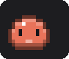 | **Idle** | Standing still | Session just opened, nothing sent yet |
|  | **Working** | Hops, white `…` | You sent a prompt; the agent is thinking or running tools |
|  | **Needs permission** | Orange background, blinking `!` | The agent is waiting for you to approve a tool call |
|  | **Asking you** | Brown background, blinking `?` | The agent asked you a question or wants a plan approved |
|  | **Compacting** | Shakes, purple `…` | The conversation is being compacted |
| 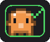 | **Done** | Green border, ✓ | The agent finished its turn; your move |
|  | **Background** | Slow cyan `…` | Turn finished, but a background shell is still running (Claude Code only) |
|  | **Asleep** | Eyes closed, floating `z` | Done or idle for 10 minutes without you coming back (configurable) |
| 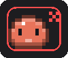 | **Error** | Red border, ✗ | The turn failed (API error, crash…) |
| 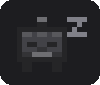 | **Closed** | Greyed out, then gone after 30 s | The session ended or its process disappeared. Sessions that were already gone when GNOME started (e.g. from before you logged out) are removed straight away |

States come from these agent events:

| State | Claude Code hook | OpenCode event |
|---|---|---|
| Idle | `SessionStart` | `session.created` |
| Working | `UserPromptSubmit`, `PreToolUse`, `PostToolUse`, `SubagentStart`… | `session.status` (busy), `permission.replied`, `question.replied` |
| Needs permission | `PermissionRequest`, `Notification` (permission prompt) | `permission.asked` |
| Asking you | `PreToolUse` for `AskUserQuestion` / `ExitPlanMode`, `Notification` (elicitation) | `question.asked` |
| Compacting | `PreCompact` | `session.next.compaction.started` |
| Done | `Stop` | `session.idle` |
| Error | `StopFailure` | `session.error` |
| Closed | `SessionEnd`, or the process no longer exists | `session.deleted`, or the process no longer exists |

**Background** and **Asleep** are worked out by the extension itself: it looks for live
background shells under the agent's process, and at how long the session has been done.

If a session has been waiting for your **permission** or an **answer** for more than two
minutes (configurable), its critter shakes, blinks twice as fast and gets a yellow border,
and the menu marks it with ⚠.

### The menu

Right-click anywhere on the critters to open the session list, in the same order as the
bar (a left click never opens it). Each session shows
`project · state · time in that state` and, on a second line, whatever is known:

| Detail | Example | Where it comes from |
|---|---|---|
| Tool in use | `Bash` | The last tool the agent called (while working) |
| Turn time | `turn 3 min` / `last turn 2 min` | From your prompt until the agent stops |
| Git branch | `⎇ main` | Read from the project's `.git/HEAD` (worktrees included) |
| Context in use | `84k context (opus-5-5)` | Tokens sent in the agent's last request, and its model |
| Subagents | `2 subagents: Explore, Plan` | Subagents started and not yet finished |

Click a session to jump to its terminal. **Preferences** is at the bottom.

### Subagents

While a session runs subagents (Claude Code's Task/Agent tool, or OpenCode child
sessions), up to four **mini critters** hop next to its critter, and disappear as each
subagent finishes.

### The whip

Are they taking too long? Click the **whip** to the right of the critters to lash every
live one: it flinches, flashes red, gets an anger mark and then hops twice as fast for a
few seconds. Keep clicking: lashes less than 1.2 s apart chain into an arcade combo floating
under the whip (`x7`), with a shout every 5 hits (`x5 COMBO!`, `x10 SUPER!`,
`x20 BRUTAL!`, `x50 LEGENDARY!`). The longer the combo, the longer they rush. The menu
shows your total lashes and your best combo.

It is purely cosmetic: the agents never find out.

### Many sessions

When there are more sessions than the maximum (8 by default), the first ones get a critter
and the rest are grouped into a **`+N`** counter. All of them are in the menu.

### The characters

<p align="center">
  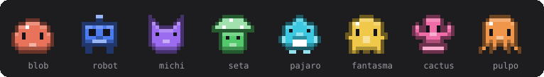
</p>

Each project gets one of eight characters in one of eight colours, picked from a hash of
its folder.

### On macOS and Windows

The IAmigos app shows the same critters, states, menu and whip as the GNOME extension:

- **macOS**: the critters sit in the **menu bar**, all in one item. Click a critter to jump
  to its terminal (the first time, macOS asks whether IAmigos may control System Events:
  that is what brings the right window forward), click the whip to lash them, and
  right-click for the menu. The `+N` counter and the combos show up as text next to them.
  They shrink to fit the menu bar.
- **Windows**: there is no top bar, so the critters live in a small **floating strip**,
  always on top, above the right end of the taskbar. Drag it anywhere; it remembers where.
  Left click a critter to jump to its terminal, right-click for the menu. The strip hides
  itself when there are no sessions. The **tray icon** shows the session that needs you
  most (with its background colour) and lists them all in its tooltip; click it to show or
  hide the strip, right-click it for the menu. Windows 11 may put a new tray icon in the
  overflow area: drag it to the taskbar to keep it in sight.

The preferences are in the menu (**Preferences ▸**), with the same settings as on GNOME,
plus **Start at login** (on by default) and, on Windows, where the strip goes.

## Preferences

On macOS and Windows they are in the menu, under **Preferences ▸**. On GNOME, open them from the menu (right-click a critter → **Preferences**), from the Extensions app,
or with `gnome-extensions prefs iamigos@iamigos`. Changes apply at once.

| Setting | Default | |
|---|---|---|
| Language | System default | English or Spanish |
| Position in the top bar | Right | Left, center or right (Windows: where the strip sits above the taskbar) |
| Critter size | 2 | Size of each sprite pixel (1–4) |
| Maximum critters | 8 | The rest are grouped into `+N`. 0 = no limit |
| Show subagents | On | Mini critters for running subagents |
| Details in the menu | On | The second line of each session |
| Fall asleep after | 10 min | 0 = never |
| Insist after | 120 s | Waiting for your permission or answer. 0 = never |
| Whip button | On | The whip to the right of the critters |
| Claude Code / OpenCode | On | Which agents to show |

## Install

Requirements: **Node 18+** (for the installer) and **Python 3** (used by the Claude Code
hook), and:

- **Linux**: GNOME Shell 48–50.
- **macOS**: 12 or later, Apple Silicon or Intel. Python 3 comes with the Xcode command
  line tools (`xcode-select --install`).
- **Windows**: 10 or 11, x64 or Arm. Python 3 from python.org or the Microsoft Store
  (`py` or `python` must work in a terminal).

```bash
npx iamigos install
```

On **Linux**, then **log out and back in**. On Wayland, GNOME only loads new extensions, or
new versions of an extension, at login. On **macOS and Windows** the app starts straight
away and from then on at every login.

```bash
npx iamigos status              # what is installed, and whether it is running
npx iamigos@latest install      # update (safe to run again at any time)
npx iamigos uninstall
```

`install` does the following:

| What | Where |
|---|---|
| Claude Code hook script | `~/.local/bin/iamigos-hook` (on Windows, run by `py -3` or `python`) |
| Hook registration for each event | `~/.claude/settings.json` (it saves a backup to `settings.json.iamigos.bak` first) |
| OpenCode plugin, if `~/.config/opencode` exists | `~/.config/opencode/plugins/iamigos.ts` |
| **Linux:** GNOME extension (marks it enabled and compiles its settings schema) | `~/.local/share/gnome-shell/extensions/iamigos@iamigos` |
| **macOS:** the IAmigos app, from the GitHub Release of the same version | `~/Applications/IAmigos.app` |
| **Windows:** the IAmigos app, from the GitHub Release of the same version | `%LOCALAPPDATA%\Programs\IAmigos` |

Your other hooks and settings are left untouched, and `uninstall` removes only what
IAmigos added. `npx iamigos install --no-app` installs only the hook and the plugin.

The macOS and Windows apps are not signed with a developer certificate yet. The installer
downloads them itself (not through a browser), so macOS opens it without complaint; if you
download a zip from the Releases page by hand, macOS will refuse to open it until you run
`xattr -dr com.apple.quarantine IAmigos.app`, and Windows SmartScreen may warn you.

## How it works

```
Claude Code ── hooks/iamigos-hook (python) ─┐
                                             ├─► ~/.local/state/iamigos/sessions/<agent>-<id>.json
OpenCode ───── opencode/iamigos.ts (plugin) ─┘                 │
                                                  Gio.FileMonitor │ fs.watch
                                                   ▼              ▼
                        gnome-extension/iamigos@iamigos (GJS)   desktop/ (Electron, macOS and Windows)
```

The folder is the same on every platform (on Windows, `%USERPROFILE%\.local\state\iamigos\sessions`),
unless `XDG_STATE_HOME` says otherwise. What each session shows, how its critter is drawn
and how its window is found live in three plain JavaScript modules shared by both front
ends: `view.js`, `paint.js` and `procs.js` (in the extension's folder, as GNOME requires).

The only contract is one JSON file per session, written atomically:

```json
{"v":1,"agent":"claude","id":"…","state":"working","detail":"Bash",
 "cwd":"/home/me/project","project":"project","pid":12345,
 "mux":{"kind":"zellij","session":"work","pane":"1"},
 "turn_started":1731350090.0,"turn_ended":null,
 "tokens":84213,"model":"claude-opus-5-5",
 "subagents":[{"id":"a1","type":"Explore","since":1731350095.5}],
 "started":1731350000.1,"since":1731350100.2,"updated":1731350100.2}
```

- `state`: one of `idle`, `working`, `permission`, `asking`, `compacting`, `done`, `error`, `closed`.
- `detail`: the tool involved, if any.
- `pid`: the agent's process, used to detect crashed sessions and to find its window.
- `mux`: where the session lives inside zellij or tmux, if it does. It is `null` in a plain terminal.
- `turn_started` / `turn_ended`: when the current or last turn started and ended.
- `tokens` / `model`: context used by the agent's last request, and the model that answered.
- `subagents`: subagents that started and have not finished yet.
- `since`: when the session entered its current state.

Every field after `pid` is optional, so a front end must cope with it being missing.

Any other front end, such as an AppIndicator, could read the same folder.

### Finding the right window

When you click a session, the extension follows the agent's parent processes until it
reaches a window. Inside **zellij** or **tmux** the agent runs under the multiplexer's
server, which is not a child of any window. In that case the extension focuses the terminal
running the multiplexer client and then switches to the session's tab and pane.

If neither works, it falls back to a window whose title contains the project name, and then
to the most recently used terminal.

On **macOS** the app does the same with `ps`: it brings forward the terminal app (the first
`.app` among the agent's parent processes, or the multiplexer client's) and then switches
the zellij or tmux pane. On **Windows** it brings forward the first parent process that has
a window, then a window whose title contains the project name, then Windows Terminal.

## Development

```bash
git clone https://github.com/jaalmansa/iamigos && cd iamigos
npm run dev-install          # like install, but symlinks to the repo instead of copying
```

Log out and back in after changing the extension; the hook and the OpenCode plugin are
picked up at once.

The macOS/Windows app lives in `desktop/`, with its own `package.json` (Electron is not a
dependency of the npm package):

```bash
cd desktop && npm install
npm start                    # runs the app from the repository (on Linux too: it shows the Windows strip)
npm run dist                 # builds the zips into desktop/dist/ (on macOS and Windows)
```

`npm start` copies the shared modules from the extension into `desktop/src/shared/` first;
edit them in `gnome-extension/iamigos@iamigos/`. To install your own build with the
installer, point it at the zip or the unpacked app:
`IAMIGOS_APP_SOURCE=desktop/dist/IAmigos-0.1.0-mac-arm64.zip node bin/iamigos.mjs install`.
`IAMIGOS_CAPTURE=strip.png npm start` saves a capture of what the app shows after 3 s.

| Command | What it does |
|---|---|
| `npm install` then `npm run check` | Lint (ESLint), type check of the OpenCode plugin and all tests |
| `npm test` | Tests only: installer, shared logic, desktop app, sprites, translations, OpenCode plugin (Node) and Claude Code hook (Python) |
| `tools/demo.sh` / `tools/demo.sh --clean` | Creates fake sessions in every state (and removes them) |
| `node tools/readme-images.mjs` | Regenerates the images in `docs/img/` from `sprites.js` |
| `node tools/preview.mjs` | Writes `docs/sprites.html`: every character × state × colour |
| `npm run pack-extension` | Builds the extension zip in `dist/` |
| `journalctl -f -o cat /usr/bin/gnome-shell \| grep -i iamigos` | Shows the extension's logs |

Characters are plain text grids in `gnome-extension/iamigos@iamigos/sprites.js`, so adding
one is a matter of drawing 12×11 characters. UI text lives in `strings.js`: every language
must have the same keys as English (a test checks it).

### Releasing

```bash
npm version patch            # bumps package.json, commits and tags vX.Y.Z
git push --follow-tags
```

The `release` GitHub Actions workflow checks that the tag matches `package.json`, builds the
macOS and Windows apps, creates a GitHub Release with their zips and the extension zip, and
then publishes to npm (repository secret `NPM_TOKEN`). In that order: the installer
downloads the app from the Release of its own version. The `ci` workflow also builds the
apps on every pull request and keeps the zips as artifacts for two weeks.

## Known limitations

- On Linux, GNOME Shell 48–50 only.
- The macOS and Windows apps are not signed with a developer certificate (see [Install](#install)).
- On Windows, IAmigos can bring Windows Terminal forward but not pick the tab, and it does
  not jump to zellij/tmux panes (they only run inside WSL there). Background shells are
  checked every 15 s, as listing processes is slow.
- On macOS, jumping to a session needs the Automation permission for System Events (asked
  the first time); without it, IAmigos only brings the terminal app forward.
- zellij 0.43 has no "focus pane by id" action, so IAmigos walks through tabs and panes until
  it finds the right one. You may see them flash for a moment.
- Detecting background shells only works with Claude Code.
- The context size is the number of tokens, not a percentage: the context window depends
  on the model and plan, and the agents do not report it.
